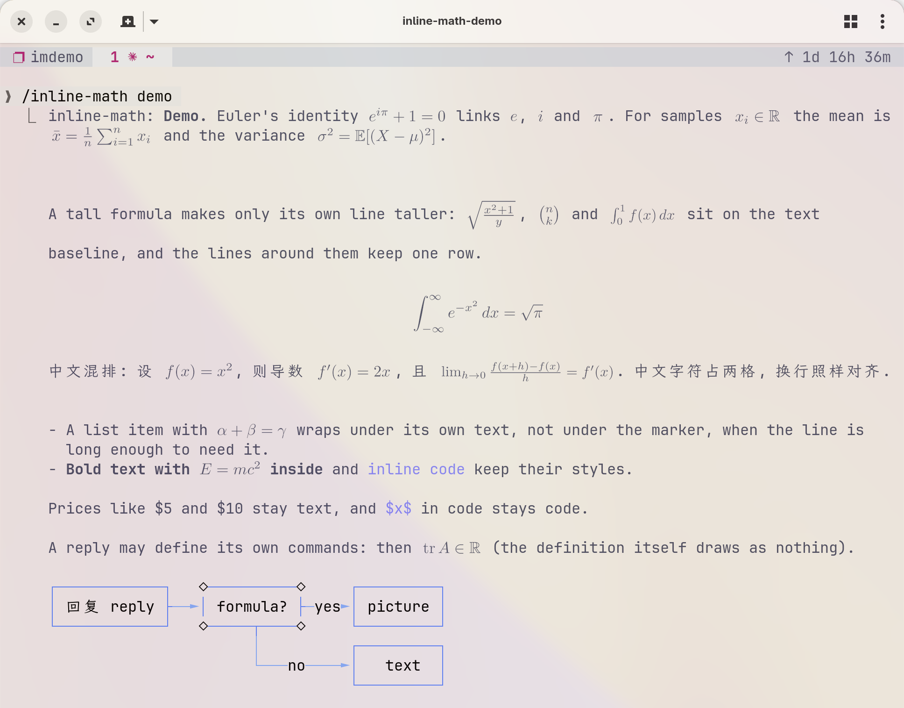

<div align="center">
  <h1>claude-inline-math</h1>
  <p><b>Typeset the LaTeX in Claude's replies and draw mermaid diagrams, right in the terminal. Works inside tmux.</b></p>
  <a href="LICENSE"></a>
  
  
  
</div>

<p align="center">
  
</p>

> 💡 This is a Claude Code mod: a plugin with a hooks module that changes how replies are drawn in the terminal, nothing else. The stored conversation is never changed, so the model, `ctrl+o`, exports and copies still see the LaTeX and mermaid source.

## Features

- **Math inline with the text**: `$e^{i\pi} + 1 = 0$` becomes a typeset picture on the text baseline, so it reads like a line in a paper, not like source code
- **Display math**: `$$...$$` and `\[...\]` are centred on their own lines; a formula wider than the reply is drawn smaller to fit
- **Works in tmux**: pictures go through tmux's passthrough to Ghostty or kitty, and the cell size comes from tmux itself
- **Fast**: a precompiled LaTeX format and a render daemon bring one new formula to about 28 ms and ten to about 60 ms; redrawing a typeset reply costs under 2 ms
- **Broad coverage**: real TeX (latex and dvipng), checked against the KaTeX function list (98.8 % drawn), MathJax extensions, `physics`, `mhchem`, `siunitx`, `amscd` and your own packages and macros
- **Mermaid diagrams as text art**: flowcharts, sequence, state, class, ER and xychart diagrams drawn in box-drawing characters, coloured by role in Catppuccin
- **Chinese, Japanese and Korean**: wide characters count as two cells, so text, CJK and formulas wrap together; `\text{面积}` typesets with CJK fonts
- **Safe by default**: Claude's formulas are typeset in a safe subset of LaTeX; nothing in a reply can read files, run programs, or change how another formula is drawn

## Quick Start

You need Claude Code 2.1.311 or later, a terminal with the kitty graphics protocol (Ghostty or kitty), a TeX distribution with `latex` and `dvipng`, and python3 with Pillow. Tested on Linux with Ghostty and tmux 3.8 (passthrough needs tmux 3.3 or later); macOS should work but is untested.

**Install TeX and Pillow**

```bash
# Arch
sudo pacman -S texlive-basic texlive-latex texlive-latexrecommended texlive-latexextra \
  texlive-binextra texlive-fontsrecommended texlive-langcjk texlive-langchinese python-pillow
# Debian and Ubuntu
sudo apt install texlive-latex-extra texlive-lang-chinese dvipng python3-pil
# macOS
brew install --cask mactex-no-gui && pip3 install --user pillow
```

The CJK packages are only needed for Chinese, Japanese or Korean text inside a formula.

**Install the mod**

Type this at the Claude Code prompt, answer `y` to add the marketplace, then pick a scope (the user scope loads it in every session):

```text
/plugin install inline-math --marketplace jczhang02/claude-inline-math
```

Or from a shell:

```bash
claude plugin install inline-math --marketplace jczhang02/claude-inline-math
```

**Inside tmux**, add these lines to `~/.config/tmux/tmux.conf` or `~/.tmux.conf`, then restart tmux:

```tmux
set -g allow-passthrough on
set -g focus-events on
```

**Run**

```text
/inline-math status          # What it found: latex, dvipng, Pillow, daemon, format, cell size, colour
/inline-math demo            # A sample reply: inline, tall, display, Chinese, a list, a macro, a flowchart
/inline-math off             # Draw replies as Claude Code does; kept across sessions
/inline-math on              # Draw formulas and diagrams again
/inline-math clear           # Forget the drawn pictures and typeset them again
```

<details>
<summary><strong>Run from a clone (for development)</strong></summary>

```bash
git clone https://github.com/jczhang02/claude-inline-math ~/Documents/dev-tools/claude-inline-math
claude --plugin-dir ~/Documents/dev-tools/claude-inline-math    # this session only
```

For every session, add the folder to `CLAUDE_CODE_PLUGIN_DIRS` in `~/.claude/settings.json` (use `:` between several folders). Claude Code reloads the mod when you save a file. Use either this or the marketplace install, not both.

```json
{ "env": { "CLAUDE_CODE_PLUGIN_DIRS": "~/Documents/dev-tools/claude-inline-math" } }
```

Update an installed copy with `claude plugin update inline-math@claude-inline-math`.

</details>

## tmux

tmux is a first-class target: the mod is developed in Ghostty inside tmux.

- **Pictures** are sent with the kitty graphics protocol. tmux passes them through to the outer terminal only with `allow-passthrough on`; without it, every formula shows as its Unicode stand-in (`x²`, `α + β`, `√π`, `ℝ`) and diagrams still draw, as they are text.
- **Cell size** decides how large a picture is. Inside tmux the mod asks tmux for the client's cell size (`#{client_cell_width}x#{client_cell_height}`), and looks again every few seconds, so it follows the terminal you attach from. Outside tmux it asks the terminal.
- **Several panes and sessions** share one render daemon and one picture cache, so a formula typeset in one pane costs no TeX run in the others.
- **Check it**: `tmux show -g allow-passthrough` must say `on`, and `/inline-math status` shows the cell size it found. If it is wrong, set the `cell` option.

## Features in Detail

### Math

A formula is kept on one text row when it fits at 80 % of its size or more; a taller one (a fraction, a sum with limits) makes only its own line taller. Bold, italic, strikethrough, inline code and links around formulas keep their styles, and list items keep their markers and hanging indents. Until a picture is ready, and when TeX cannot typeset a formula, its Unicode stand-in takes its place.

Not math: code spans and code blocks, `\$`, and prices such as `$5 and $10` (the pandoc rule: an opening `$` must be followed by a non-space, a closing `$` must follow a non-space and must not be followed by a digit). Headings, tables and blockquotes are drawn by Claude Code's own Markdown renderer, so a formula inside one shows as its Unicode stand-in.

What TeX can typeset, and what it cannot, is listed in [docs/compatibility.md](docs/compatibility.md): the KaTeX function list, MathJax extensions, commands that only make sense on the web (`\href`, `\htmlClass`, `\style`, ...), which draw as their content, and the best-effort cases (tikz-cd, Traditional Chinese, Korean).

```text
$ python3 bin/coverage.py
katex     1185/1200    98.8 % drawn   15 allowed failures, 0 other failures
mathjax    142/150     94.7 % drawn   8 allowed failures, 0 other failures
claude     239/239    100.0 % drawn   0 allowed failures, 0 other failures
```

### Diagrams

A closed ` ```mermaid ` block, at the top level of a reply or in a list item, is drawn by the bundled [beautiful-mermaid](https://www.npmjs.com/package/beautiful-mermaid) library (MIT, `hooks/vendor/`). Boxes are blue and lines lavender (Catppuccin Latte on a light desktop, Mocha on a dark one), labels in the text colour; `diagramColor: false` draws them in the text colour alone. Loops (a retry, a training loop, `A --> A`) are routed around the side of the boxes, with their own arrowheads and labels.

```text
┌────────┐        ┌─────┐     ┌────────┐  ┌──────────┐
│ Claude │        │ Mod │     │ Daemon │  │ Terminal │
└────┬───┘        └──┬──┘     └────┬───┘  └─────┬────┘
     │  reply text   │             │            │
     │───────────────▶             │            │
     │               │  formulas   │            │
     │               │─────────────▶            │
     │               │  pictures   │            │
     │               ◀╌╌╌╌╌╌╌╌╌╌╌╌╌│            │
     │               │      text + images       │
     │               │──────────────────────────▶
┌────┴───┐        ┌──┴──┐     ┌────┴───┐  ┌─────┴────┐
│ Claude │        │ Mod │     │ Daemon │  │ Terminal │
└────────┘        └─────┘     └────────┘  └──────────┘
```

A diagram the mod cannot draw correctly is shown as source, with one dim line under it that says why, never as a drawing that says something the source does not:

- Other kinds (`pie`, `gantt`, `mindmap`, ...) and blocks the library cannot parse.
- Diagrams that are too big: more than 80 rows, 8000 characters or 150 lines, a flowchart of more than 100 nodes or 60 nodes in subgraphs, or wider than the reply.
- A few loops the layout cannot route: a cycle that enters a subgraph, edges both ways between two nodes of the same layer, an edge written twice, and a node with a self loop plus another loop.
- A flowchart or state diagram whose drawing dropped an edge, an arrowhead or a label, put a line inside a box, or ran a line off the canvas, after the other layouts were tried.

`style`, `classDef`, `class`, `linkStyle` and `click` statements are ignored; entity codes (`#quot;`) and markdown-string labels draw as their text.

### Reply macros

Claude sometimes defines a command in a reply and uses it later in the same reply:

```latex
$$\newcommand{\norm}[1]{\left\lVert #1 \right\rVert}$$
Then $\norm{x} \le 1$ for every $x$.
```

The mod expands such definitions as text before TeX sees a formula, and the definition itself draws as nothing. The expanded formula still goes through the safety check.

<details>
<summary><strong>Rules</strong></summary>

- `\newcommand`, `\renewcommand`, `\providecommand`, `\def`, `\let` and `\DeclareMathOperator`, also with `\global` before them.
- The scope is one reply (one text block), headings and tables included (as Unicode there). Definitions do not carry over to the next reply.
- A name defined twice takes its last definition, wherever in the reply it is; `\providecommand` does not replace an earlier definition.
- Arguments are pasted as TeX reads them: `\lVert#1` with `x` gives `\lVert x`, not the unknown `\lVertx`. A macro whose body is empty draws as nothing.
- Arguments `#1` to `#9`, with an optional first argument and its default. `\def` takes undelimited parameters only; a `\def` with delimited parameters, `\edef` and `\xdef` are not expanded, and TeX refuses them.
- Expansion stops at 32 levels of nesting or 8000 characters; a formula past either limit is drawn as written, which TeX then refuses.

</details>

### Streaming

Claude Code draws a reply's text itself while it streams, so formulas show as LaTeX source until their text block is finished; a mod cannot replace that live text. Meanwhile the mod reads the stream (without changing it) and queues each formula for TeX once its closing `$` has arrived. When the block ends, its formulas are usually typeset already and appear at once. A formula closed just before the block ends can show as its Unicode stand-in for one backend round trip (about 30-60 ms).

### Speed

Measured with `python3 bin/bench.py`, from process start to exit, as Claude Code runs it:

| Case | 1 new formula | 10 new formulas |
| --- | --- | --- |
| Daemon running | 28 ms | 59 ms |
| Daemon starting | 260 ms | 300 ms |
| Already cached | | 23 ms |
| Chemistry (`\ce`), daemon running | 90 ms | 205 ms |

<details>
<summary><strong>How it stays fast</strong></summary>

- **Precompiled format.** The whole preamble (fonts, `amsmath`, `mathtools`, the symbol packages, your `packages` and `macros`) is dumped once into a LaTeX format in `~/.cache/claude-inline-math/fmt/`. It is built again by itself when TeX Live, the options or the renderer change.
- **Render daemon.** `bin/client.py` (standard library only, quick to start) hands each request to `bin/renderd.py`, which keeps Pillow loaded, keeps TeX processes waiting with the format read, and keeps `dvipng` running. Its socket is in `$XDG_RUNTIME_DIR/claude-inline-math/` (else `/tmp/claude-inline-math-<uid>/`, else `~/.cache/claude-inline-math/run/`), a folder only you can use. It serves every session you have open, stops after 30 minutes without a request, and replaces itself when the renderer files change. When it cannot be reached, `client.py` renders in its own process: slower, the same pictures.
- **Batches.** Formulas asked for within 30 ms share one call of up to 16. Formulas found while a reply streams gather for up to 400 ms, also while a call is running, so a long reply costs a few calls. A batch heavy with chemistry is split over the waiting TeX processes.
- **Warm start.** When a turn starts after a pause of a minute or more, the mod starts the daemon while Claude is still thinking.
- **Cheap redraws.** Each reply is parsed once, and a reply whose pictures are ready returns its last drawing. When pictures arrive, only the replies that waited for them are drawn again.
- **Disk cache.** Pictures are kept in `$XDG_CACHE_HOME/claude-inline-math` (else `~/.cache/claude-inline-math`), keyed by the renderer version, so a formula seen before costs no TeX run.

</details>

## Options

Set them in `/config`, or in `~/.claude/settings.json` under `pluginConfigs`:

```json
{
  "pluginConfigs": {
    "inline-math": {
      "options": {
        "packages": "physics, tensor",
        "macros": "\\newcommand{\\R}{\\mathbb{R}}\n\\DeclareMathOperator{\\tr}{tr}"
      }
    }
  }
}
```

| Option | Default | Meaning |
| --- | --- | --- |
| `enabled` | `true` | Draw formulas and diagrams. `/inline-math on` or `off` overrides it. |
| `foreground` | `auto` | Formula colour. `auto` follows the desktop's light or dark scheme (Catppuccin Latte text `#4c4f69`, Mocha text `#cdd6f4`); or `#rrggbb`. |
| `cell` | `auto` | One character cell in pixels. `auto` asks tmux, then the terminal; or `WxH`, such as `19x42`. |
| `baseline` | `0.773` | Where the font's baseline sits in a cell, from the top, as a fraction of the cell height. 0.773 is JetBrains Mono. |
| `ptPx` | `3.4` | Formula size in pixels per TeX point. 3.4 matches a 12 pt font with 42 px cells. |
| `minShrink` | `0.8` | How far an inline formula may shrink to stay on one row before it takes more rows. |
| `promptHint` | `true` | Add a short note (under 100 tokens) to Claude's system prompt: write math as `$...$` and `$$...$$`, never in code blocks; mermaid blocks draw as diagrams. |
| `packages` | empty | Extra TeX packages for every formula, separated by commas or spaces. A package that is not installed, or a bad name, is skipped and named in `/inline-math status`. |
| `macros` | empty | Your own definitions for every formula: `\newcommand`, `\DeclareMathOperator`, `\def`, one or more lines. In `settings.json` write `\n` between lines and `\\` for each backslash. |
| `diagramColor` | `true` | Colour diagrams by role. Off: the text colour alone. |

<details>
<summary><strong>How packages and macros combine</strong></summary>

`packages` and `macros` are yours, so they go into the preamble (and the format) without the safety check that Claude's formulas get. They load before the mod's own stand-ins, so a package's command wins over the mod's: with `physics`, `\abs`, `\dv`, `\pdv` and `\qty` are physics's own (and physics also redefines `\div`, `\Re` and `\Im`). Your `macros` win over a package: a name you define with `\newcommand`, `\DeclareMathOperator` or `\DeclarePairedDelimiter` replaces the package's command of that name, instead of stopping LaTeX with "already defined".

When the preamble still does not work, the mod keeps what works: your `macros` if they work alone, then each package that still works when added. Each one left out is named, with TeX's error, in `/inline-math status`. Changing either option typesets every formula again.

</details>

## Limitations

- Pictures need the kitty graphics protocol. iTerm2, WezTerm, Alacritty, VS Code's terminal and Windows Terminal show the Unicode stand-ins; diagrams still draw.
- Only the terminal is drawn. The desktop app, VS Code and mobile show replies as they always do.
- Text in a paragraph with a formula copies as the text around the pictures; a picture copies as nothing. Use `ctrl+o` to see and copy the source.
- The formula colour follows the desktop scheme (through the XDG portal or GNOME's setting), not a theme set in the terminal alone. Set `foreground` if they differ.
- After the terminal font size changes, pictures are typeset again within a few seconds; until then the terminal scales them.
- A formula that mixes Chinese, Japanese and Korean text fails: one CJK font is chosen per formula.

## Troubleshooting

- **Formulas show as Unicode, never as pictures.** Run `/inline-math status` and install what it names, then `/inline-math clear`. If the backend is ready, check that the terminal is Ghostty or kitty and that `tmux show -g allow-passthrough` says `on`. Restart tmux after you change its config.
- **Formulas are slow to appear.** `/inline-math status` shows the daemon and the format. `daemon: not reached` means each batch starts TeX from nothing; the status names each folder the socket could not use and why. `format: not built` usually means a package or macro breaks the preamble, also named there. The first formula after a TeX Live update or an option change waits a few seconds for the format.
- **Stop the daemon or rebuild the format.** `pkill -f renderd.py` stops the daemon; the next formula starts a new one. Deleting `~/.cache/claude-inline-math/fmt/` makes the next formula build the format again. Then run `/inline-math clear`.
- **Formulas sit too high or too low.** Set `baseline` for your font, and `cell` if tmux reports the wrong size (`tmux display -p '#{client_cell_width}x#{client_cell_height}'`).
- **Formulas are too large or too small.** Change `ptPx`.
- **One formula shows as text.** TeX refused it; `/inline-math status` lists recent errors. Check [docs/compatibility.md](docs/compatibility.md).
- **A diagram shows as source.** The dim line under it says why. A wider window helps when it is too wide.
- **Claude writes math in code blocks.** Check that `promptHint` is on; the note applies from the next turn.
- **Something looks wrong.** `/inline-math off` draws replies as Claude Code does; `claude --debug` logs why a hook was skipped.

## License

MIT, see [LICENSE](LICENSE). The bundled beautiful-mermaid library is MIT too, see [hooks/vendor/LICENSE](hooks/vendor/LICENSE).
